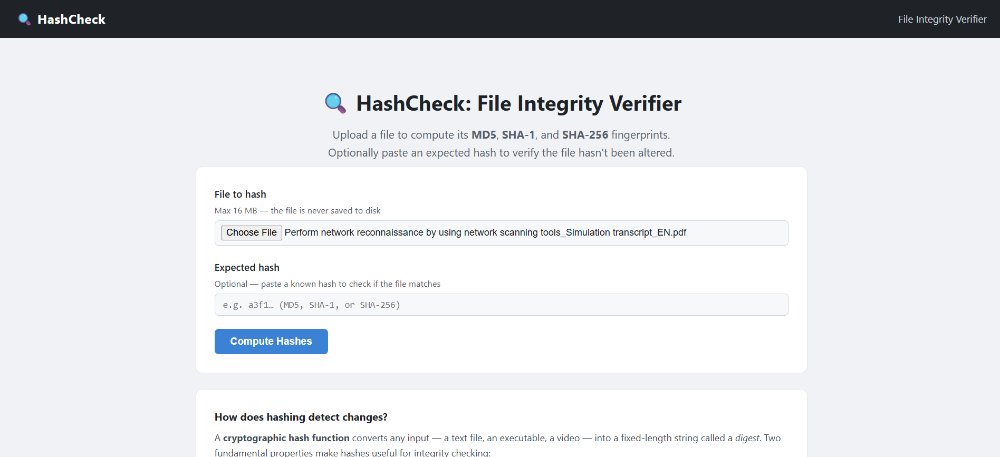
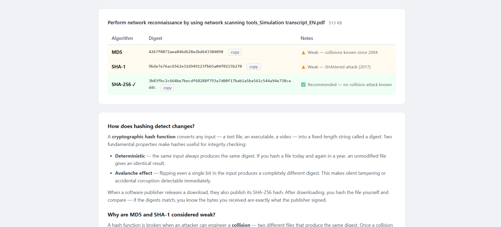
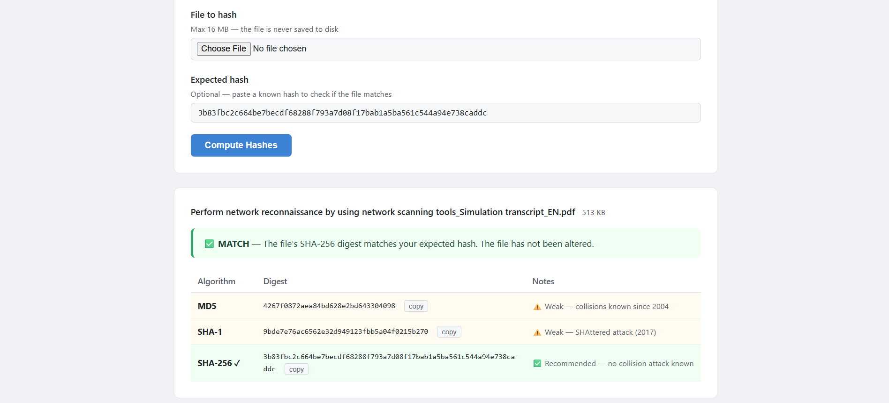
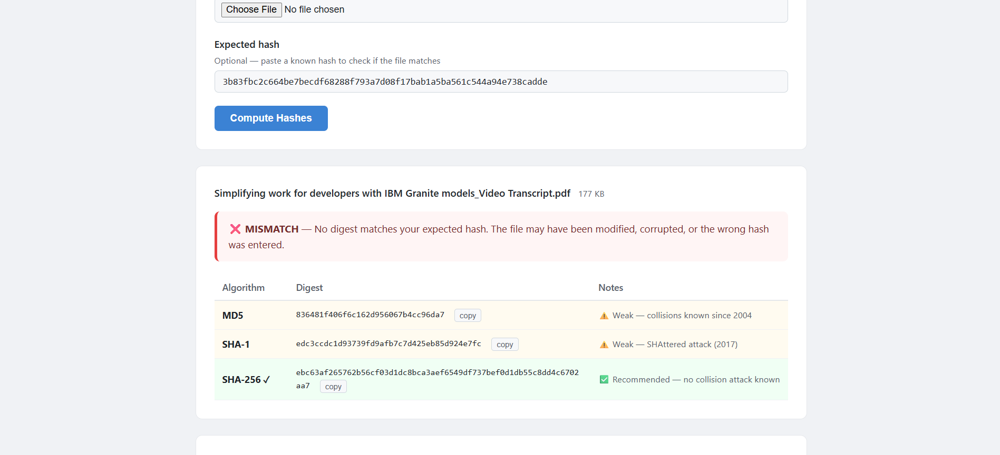

# HashCheck: File Integrity Verifier

A lightweight Python Flask web application that computes MD5, SHA-1, and SHA-256 hashes for any uploaded file.  
Upload a file, copy its digest, and optionally paste an expected hash to instantly verify the file has not been tampered with or corrupted.

> **MSc Cybersecurity project** — Variya Dhruvi

---

## Features

- 📁 **Upload any file** up to 16 MB via a clean web interface
- 🔐 **Three hash algorithms** computed in a single pass: MD5, SHA-1, and SHA-256
- ✅ **Expected-hash comparison** — paste a known hash to get a clear MATCH or MISMATCH result
- 🔍 **Auto-detects algorithm** from the hash length you paste (32 → MD5, 40 → SHA-1, 64 → SHA-256)
- 📋 **Copy buttons** for each digest
- ⚠️ **Security explainer** on why MD5 and SHA-1 are considered weak
- 🚫 **Files are never written to disk** — the stream is processed entirely in memory
- 🛡️ **Friendly error page** for files that exceed the 16 MB limit

---

## How It Works

1. The user selects a file and (optionally) enters an expected hash in the web form.
2. Flask passes the file's binary stream to `compute_hashes()` in `tools/hash_tool.py`.
3. The stream is read in **64 KB chunks**. All three hash objects (`md5`, `sha1`, `sha256`) are updated on every chunk in a single pass — the file is never fully loaded into memory.
4. The digests are returned as lowercase hex strings and rendered on the results page.
5. If an expected hash was provided, its length determines which algorithm to compare against, and a MATCH or MISMATCH banner is shown.

---

## Technologies Used

| Technology | Version | Purpose |
|---|---|---|
| Python | 3.10+ | Core language |
| Flask | 3.x | Web framework and routing |
| hashlib | stdlib | MD5, SHA-1, SHA-256 hashing |
| Jinja2 | bundled with Flask | HTML templating |
| Werkzeug | bundled with Flask | File upload handling |

---

## Project Structure

```
SentinelDesk/
├── app.py                  # Flask app, routes, config
├── requirements.txt        # Python dependencies
├── static/
│   └── style.css           # Stylesheet
├── templates/
│   ├── base.html           # Shared page layout
│   ├── hash_tool.html      # Hash checker UI (form + results)
│   └── index.html          # Root placeholder (redirects to /hash)
└── tools/
    ├── __init__.py
    └── hash_tool.py        # compute_hashes() — core hashing logic
```

---

## Installation

**Prerequisites:** Python 3.10 or later.

Clone or download the project, then install the single dependency:

```powershell
py -m pip install -r requirements.txt
```

---

## How to Run

```powershell
py app.py
```

The terminal will show:

```
* Running on http://127.0.0.1:5000
```

Open your browser and navigate to:

```
http://127.0.0.1:5000
```

You will be redirected automatically to the hash checker at `/hash`.  
Press **Ctrl + C** in the terminal to stop the server.

---

## Usage Example

1. Click **Choose File** and select any file (e.g. `final_certificate.pdf`).
2. *(Optional)* Paste a SHA-256 hash from a trusted source into the **Expected hash** field.
3. Click **Compute Hashes**.
4. The results page shows:

| Algorithm | Digest | Notes |
|---|---|---|
| MD5 | `ed2ad5e003ddce14a15815f63c7fab5a` | ⚠️ Weak |
| SHA-1 | `ef35486d4f13bd4828eb3fd644ca38abce9703db` | ⚠️ Weak |
| SHA-256 | `b806d02d77bd92c392e4686eba90d43f...` | ✅ Recommended |

If the expected hash matches, a green **MATCH** banner is shown.  
If it does not match, a red **MISMATCH** banner is shown.

---

## Screenshots

> *(Add your screenshots to a `docs/screenshots/` folder in the repo, then these images will render automatically.)*

**Upload form**



**Hash values**



**Hash results with MATCH**



**Hash results with MISMATCH**



---

## Security Notes

- **SHA-256 is the only recommended algorithm** for security-sensitive comparisons. Use it whenever you need to verify that a file has not been maliciously modified.
- **MD5 is cryptographically broken.** Collision attacks have been practical since 2004. An attacker can deliberately create two different files that share the same MD5 digest. Do not rely on MD5 for security.
- **SHA-1 is cryptographically broken.** The SHAttered attack (2017) produced two real PDF files with the same SHA-1 digest for under USD 100,000 in cloud compute. Browsers and certificate authorities stopped accepting SHA-1 years ago.
- Both MD5 and SHA-1 are still reliable for detecting **accidental** corruption (bit-rot, incomplete downloads) because collisions require deliberate crafting.
- Uploaded files are processed in memory only and are **never persisted to disk**, reducing exposure in case of a server compromise.
- The app is configured with `debug=False`. Never enable `debug=True` on a publicly accessible server — it exposes source code and allows arbitrary code execution.

---

## Limitations

- **MD5 and SHA-1 digests do not provide security guarantees** against a motivated attacker. Always use SHA-256 for integrity checks that matter.
- **A matching hash does not prove a file is safe.** It only proves the file matches the reference copy. If the reference itself is malicious, the hash will still match.
- **No virus or malware scanning** is performed. HashCheck only computes digests; it makes no claims about the file's content or safety.
- The 16 MB upload limit may be insufficient for large installer packages or disk images.
- There is no user authentication. Anyone with access to the URL can use the tool.

---

## Future Improvements

- [ ] Add support for SHA-512 and BLAKE2 / BLAKE3
- [ ] Allow users to upload a checksum file (e.g. `.sha256`) for automatic comparison
- [ ] Drag-and-drop file upload
- [ ] Increase or make the upload size limit configurable via environment variable
- [ ] Add basic authentication to restrict access
- [ ] Dockerise the app for easy deployment
- [ ] Add a REST API endpoint (`POST /api/hash`) for programmatic use

---

## Ethical Use

This tool is intended for legitimate file integrity verification only.  
**Only use it on files you own or have explicit permission to inspect.**  
Do not use it to analyse files obtained without authorisation.  
The author accepts no responsibility for misuse.

---

## Author

**Variya Dhruvi**  
MSc Cybersecurity  

---

*Built with Python 3 and Flask.*
